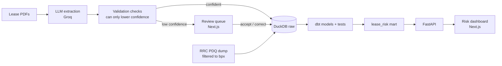

# bpx land risk

Turns oil and gas lease documents into structured records, joins them to public Texas Railroad Commission (RRC) production for bpx's wells, and flags leases at risk of lapsing.

The demo in one sentence: a scanned lease becomes a confidence-scored record in seconds, a person checks only the shaky fields, and the record lands in a risk view that shows which leases need action and by when.

> **Synthetic documents.** The lease PDFs are generated for this demo, watermarked on every page, and name a fictional lessee. Only the production data is real (public RRC data). Nothing here is a real bpx record.

## How it works



1. **Extract.** Each PDF's text goes to an LLM, which returns every field with a value, a self-reported confidence and a verbatim evidence quote.
2. **Validate.** Deterministic checks can only lower confidence: the evidence must appear in the document (a hallucination guard), values must be in plausible ranges, and documents that state two royalty rates (an Exhibit A rider) or separate execution and effective dates are capped below the review threshold.
3. **Review.** Fields under the threshold (default 0.85) go to a review queue that shows the field, the evidence and the PDF side by side.
4. **Model.** dbt applies reviews, pivots the fields into a typed `leases` table, attributes RRC production to each tract, and builds `lease_risk`.
5. **Act.** The dashboard shows a plat-style grid of tracts by risk, a "what to do next" list ordered by deadline, and a page per lease.

### Risk rules

| Flag | Rule | Severity |
| --- | --- | --- |
| Shut-in payment overdue | Production stopped, the lease has a shut-in clause, and the payment deadline (cessation + grace days) has passed | High |
| Term ended, never produced | Primary term is over and no production is linked to the tract | High |
| Production stopped | Past the primary term and no production for 3+ months (high at 6+, or with no shut-in clause) | Medium to high |
| Term ending, undeveloped | Primary term ends within 180 days and nothing has produced (high within 90) | Medium to high |
| Shut-in payment due soon | Payment deadline within 60 days | Medium |
| Fields awaiting review | Any field still in the review queue | Low |

Production gaps are measured against the latest month RRC has reported, not today, because RRC data lags two to three months. Thresholds live in `dbt/dbt_project.yml` vars.

## Quick start (offline, about two minutes)

Runs everything on a synthetic RRC sample and a mock extractor, so you need no data download and no API key.

Requires Python 3.11+ and Node 20+ (CI runs Python 3.12 and Node 22).

```bash
python -m venv .venv
# macOS/Linux: source .venv/bin/activate     Windows: .venv\Scripts\activate
pip install -r requirements.txt

python cli.py demo      # sample RRC data -> 18 synthetic leases -> mock extraction -> dbt build -> evaluation
python cli.py serve     # API on http://localhost:8000

# in a second terminal
cd web
npm install
npm run dev             # app on http://localhost:3000
```

DuckDB allows one writer at a time, so stop `serve` before re-running `demo`, `build` or any other pipeline command.

## Real run: bpx's wells and Groq extraction

1. **Set up secrets.** Copy `.env.example` to `.env` and add your `GROQ_API_KEY`. `.env` is gitignored; never commit it.
2. **Download the RRC production dump.** From the RRC [Data Sets Available for Download](https://www.rrc.texas.gov/resource-center/research/data-sets-available-for-download/) page, get the Production Data Query Dump (`PDQ_DSV.zip`, about 3.7 GB, refreshed monthly).
3. **Load bpx's leases.** This streams the zip and keeps only operators matching `RRC_OPERATOR_PATTERN` (default `^BPX`). Check the matched names it prints and tighten the pattern if needed.
   ```bash
   python cli.py ingest-rrc --zip path/to/PDQ_DSV.zip --since 201801
   ```
4. **Generate leases tied to those RRC leases,** extract them with Groq, score the extraction and build:
   ```bash
   python cli.py generate --count 18
   python cli.py extract --provider groq
   python cli.py evaluate
   python cli.py build
   python cli.py serve
   ```

`evaluate` prints per-field accuracy plus the two numbers that matter: **auto-accept precision** (how often fields that skipped review were right) and **review load** (the share of fields a person still checks).

## Commands

| Command | What it does |
| --- | --- |
| `python cli.py demo` | Full offline run on sample data |
| `python cli.py sample-rrc` | Write and load the synthetic RRC sample only |
| `python cli.py ingest-rrc --zip ...` | Load the real PDQ dump, filtered to one operator |
| `python cli.py generate` | Generate synthetic lease PDFs and their answer key |
| `python cli.py extract --provider groq` | Extract fields (`--provider mock` works offline) |
| `python cli.py evaluate` | Score extraction against the answer key |
| `python cli.py build` | Run dbt models and tests |
| `python cli.py serve` | Start the API |

## Project layout

```
landrisk/         Python pipeline: RRC ingest, lease generator, extraction, evaluation
dbt/              dbt project (DuckDB): staging, intermediate, marts, tests
api/              FastAPI service
web/              Next.js app: risk dashboard, lease pages, review queue
data/             Local database, PDFs and downloads (gitignored)
```

## Data notes

- **RRC leases are not mineral leases.** RRC assigns regulatory lease numbers per district; production is reported per RRC lease, not per well. `raw.tract_rrc_xref` plays the role of the land system's mapping from tracts to the RRC leases they feed, with an allocation share.
- **The PDQ dump** is `}`-delimited with a header row, no quoting and space-padded values, one `.dsv` per table ([RRC PDQ dump manual](https://rrc.texas.gov/media/50ypu2cg/pdq-dump-user-manual.pdf)).
- **Scanned leases** need OCR before extraction; the generated PDFs have a text layer.
- **The SQL is Snowflake-ready.** Models use standard SQL plus a few DuckDB functions (`list_filter`, `arg_max`, `date_diff`) that have direct Snowflake equivalents.

## Next steps

- "Ask Land": natural-language questions over the marts, with citations to the source lease.
- Continuous drilling clause tracking from RRC permit and completion dates.
- Louisiana (SONRIS) production for the Haynesville.
- A Palantir Foundry slice: Lease, Tract, Well and Owner as ontology objects with a "flag for review" action.
